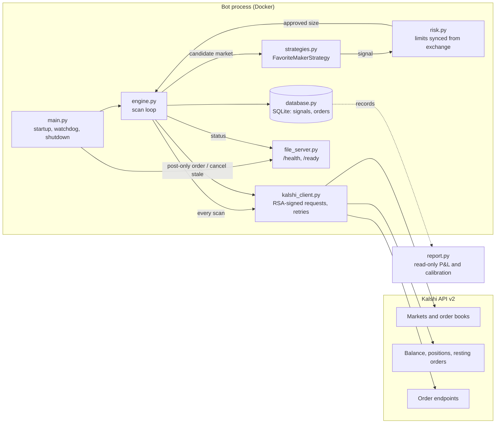

# Kalshi Trading Bot

An automated trading system for [Kalshi](https://kalshi.com), the US-regulated (CFTC) prediction market. It scans markets, posts small post-only limit orders on the favorite side, enforces hard risk limits synced from the exchange, and keeps itself running unattended in a container.

This public repo is the full system with an **example strategy**. The production strategy (extra market filters, tuned settings) and all trading records stay private. See [What's not in this repo](#whats-not-in-this-repo).

**Results, honestly:** this is a small-stakes learning system. The private deployment trades real money in roughly $1 bets. That is far too few, far too small bets to claim a proven edge, and nothing here claims one. What this repo shows is the engineering: risk controls, reliability, testing, and a report that measures whether the edge is there instead of assuming it ([sample report on synthetic data](docs/SAMPLE_REPORT.md)).

## The strategy: favorite-longshot bias, as a maker

Betting markets have a long-documented **favorite-longshot bias**: contracts priced as likely winners win a bit more often than their price implies, and longshots win less ([Snowberg & Wolfers, *Explaining the Favorite-Long Shot Bias*, Journal of Political Economy, 2010](https://doi.org/10.1086/655844)). A study of 300,000+ Kalshi contracts (Bürgi, Deng & Whelan, *Makers and Takers: The Economics of the Kalshi Prediction Market*, working paper) found the bias on Kalshi too, and that traders who post resting orders (makers) do far better than traders who cross the spread (takers).

So the example strategy (`FavoriteMakerStrategy` in `strategies.py`):

1. Looks at markets closing between 15 minutes and 14 days from now.
2. Picks the favorite side if it's priced 60-95c, the spread is tight and there's volume.
3. Rests a **post-only** limit order at the best bid. It never crosses the spread, which on most Kalshi series means **no fee**, so the small edge isn't eaten by costs.
4. Holds to settlement. One bet per event, never both sides of the same game.

The edge per bet is a few cents at best, and research suggests it shrinks as markets mature. The only honest way to know if it exists for this bot is to measure it, which is what the [report](#measuring-the-edge) does.

## Architecture



One scan cycle: fetch markets in the time window, sync cash / positions / resting orders from the exchange, cancel stale quotes, run each candidate through the strategy, size it with the risk manager, place a post-only order, log it.

## Risk controls

All limits use numbers read back from the exchange, not the bot's own memory.

| Control | What it does |
| --- | --- |
| Per-trade cap | A percentage of account value, with a floor and a hard ceiling (`MAX_POSITION_USD`, $1 by default) |
| Cash check | Every order is sized to the cash actually available |
| Exposure caps | Total money in positions (`MAX_TOTAL_EXPOSURE_USD`), open positions, resting orders |
| Daily loss limit | Measured against account value at UTC midnight; the bot stops for the day when hit |
| One bet per event | Never holds or quotes two markets of the same game |
| Duplicate protection | The same signal can't fire twice in a short window |
| Fee filter | Post-only orders only; never crosses the spread |
| Stale quotes | Resting orders older than `MAKER_REFRESH_SEC` are cancelled and re-posted at the current bid, so they don't get picked off |
| Shutdown | All open orders are cancelled on SIGTERM / SIGINT |

Order placement is never retried blindly (a timeout could mean the order went through). Reads are retried with backoff on rate limits and server errors.

## Reliability

- Runs in Docker; built to auto-deploy from git with a health-checked rollout.
- `/ready` answers as soon as the process is up (deploy health check). `/health` returns 200 while scans succeed and 503 if they stall. The public answer is only `healthy` + seconds since the last good scan; cash, P&L and positions need `HEALTH_TOKEN` (`?token=` or `Authorization: Bearer`, constant-time compare).
- A watchdog exits the process if the scan loop stalls, so the host restarts it fresh.
- Exchange outages are retried forever; only a broken config (for example an unreadable key) stops trading, and `/health` says why.
- Starts in Kalshi's **demo** exchange (fake money) unless `KALSHI_DEMO_MODE=false`.

## Measuring the edge

`report.py` is read-only (no orders, no network). Given a file of settled bets it reports:

- settled / open bets, win rate with a 95% Wilson interval
- **average price paid vs realized win rate**: the price is the market's implied probability, so win rate above price is the edge
- a z-score of wins against what the prices implied (|z| < 2: can't tell yet)
- Brier score, realized P&L net of fees, fees, return on stake, max drawdown
- a **calibration table per 5c price bucket**

```bash
python -m report bets.jsonl                         # markdown
python scripts/synthetic_report.py --out docs/SAMPLE_REPORT.md
```

[`docs/SAMPLE_REPORT.md`](docs/SAMPLE_REPORT.md) is generated from **synthetic, randomly simulated bets** with no edge built in. It is not a trading record. It is useful anyway: with 500 bets and zero true edge, single buckets still swing by ±6 points, which is why the report shows intervals and a z-score instead of a headline win rate.

## Testing

```bash
pip install -r requirements.txt
python -m pytest -q            # or: python -m unittest discover -s tests -v
```

36 offline tests, no network and no money. A fake Kalshi exchange stands in for the API. They cover the bugs that actually happened during development: the bot must keep trading past its 10th order, money fields must be parsed as dollars not cents, the daily loss limit must trip and reset, position slots must free up after settlement, stale quotes must be cancelled, outages must be survived, and the health check must go red when scans stop. Report and health-gate tests use synthetic data.

## Run it

```bash
pip install -r requirements.txt
cp .env.example .env          # add your Kalshi API key id + private key path
python main.py                # demo exchange by default
```

## Code tour

| File | What it does |
| --- | --- |
| `engine.py` | Scan loop: fetch markets, sync from exchange, size, place and refresh orders, status |
| `strategies.py` | Example `FavoriteMakerStrategy`, plus earlier arbitrage / edge / market-making experiments |
| `risk.py` | Position sizing, exposure caps, daily loss limit, all synced from the exchange |
| `kalshi_client.py` | Kalshi API v2 client: RSA-PSS signed requests, order endpoints, retries |
| `database.py` | SQLite log of signals and orders |
| `report.py` | Read-only performance and calibration report |
| `file_server.py` | `/health` (token-gated detail) and `/ready` |
| `main.py` | Startup, watchdog, graceful shutdown |
| `matcher.py`, `polymarket_client.py` | Early cross-exchange arbitrage experiment (off by default) |
| `scripts/synthetic_report.py` | Generates the synthetic sample report |
| `tests/` | Offline tests against a fake exchange |

## What's not in this repo

On purpose:

- **The production strategy**: extra market filters and tuned parameters. The example strategy here is the basic price-band / spread / volume / timing version.
- **Trading records and real results**: no fills, P&L, balances or account data. The private deployment runs the same report on its own records.
- **Production-only extras**: fill-quality (adverse selection) tracking, per-category exposure caps, a daily new-order cap and watch-only paper tracking of new market types.
- **Deployment config and credentials.** `.env`, keys and data are git-ignored.

## Known limitations

- Tiny sample and tiny stakes: no statistically meaningful result yet.
- The arbitrage, "edge" and market-making strategies are earlier experiments, kept for reference and not used by default.
- Fill times are inferred from position changes between syncs, so they're approximate.
- Not financial advice.
